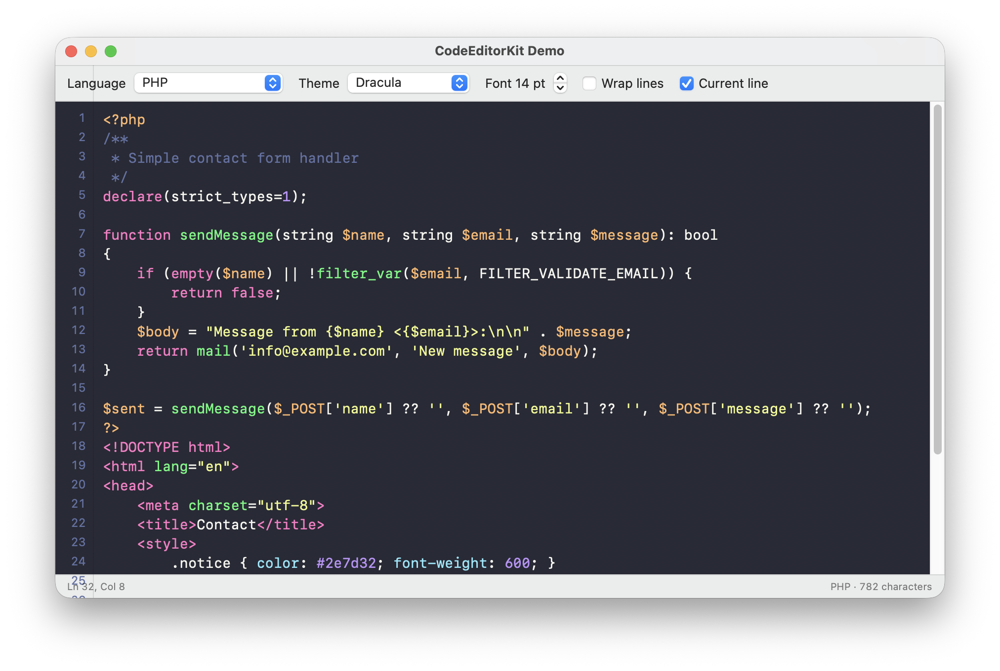
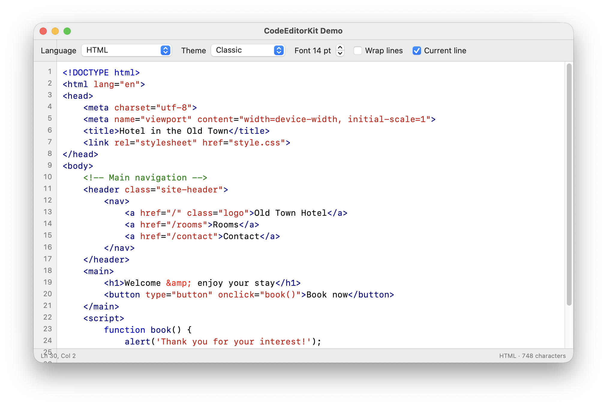

# CodeEditorKit

A lightweight **SwiftUI code editor for macOS** – line numbers, syntax highlighting, themes
and the small things that make typing code pleasant.

Extracted from **DriveHosting FTP**, a macOS SFTP/FTP client with a built-in code editor
made by [DriveSpace.cz](https://www.drivespace.cz).



## Features

- **Line numbers** in a native ruler that follows scrolling and font size
- **Syntax highlighting** – PHP (with embedded HTML, CSS and JavaScript), HTML, CSS / SCSS,
  JavaScript / TypeScript, JSON, SQL, XML / SVG, Markdown and Apache `.htaccess`
- **6 built-in themes** – System (light / dark), Classic, Solarized Light, Solarized Dark, Monokai, Dracula –
  or define your own `CodeTheme`
- **Current line highlight**, optional **line wrapping**
- **Auto-indent** on Return, **Tab / Shift-Tab** indents and outdents selected lines (undoable)
- **Auto-closing** of brackets and quotes, wrapping a selection, skipping over closing characters
- **HTML tag closing** – type `<div>` and `</div>` appears
- Native `NSTextView` underneath – Find bar (⌘F), undo, system text services
- Language detection from a file name: `CodeLanguage(fileName: "index.php")`
- No dependencies



## Requirements

- macOS 14 Sonoma or later
- Swift 5.9 / Xcode 15 or later

## Installation

**Xcode:** File → Add Package Dependencies… → `https://github.com/drivespace/CodeEditorKit`

**Package.swift:**

```swift
dependencies: [
    .package(url: "https://github.com/drivespace/CodeEditorKit", from: "1.0.0"),
]
```

## Usage

```swift
import SwiftUI
import CodeEditorKit

struct ContentView: View {
    @State private var code = "<?php echo 'Hello, world!'; ?>"

    var body: some View {
        CodeEditor(text: $code, language: .php)
    }
}
```

### Configuration

```swift
CodeEditor(
    text: $code,
    language: CodeLanguage(fileName: "style.css"),
    configuration: CodeEditorConfiguration(
        fontSize: 14,
        theme: .dracula,
        tabWidth: 2,
        useSpaces: true,
        wrapLines: true
    ),
    onCursorChange: { line, column in
        print("Ln \(line), Col \(column)")
    }
)
```

| Option | Default | |
|---|---|---|
| `fontName` | `nil` (SF Mono) | PostScript font name |
| `fontSize` | `13` | |
| `lineSpacing` | `1.15` | line height multiple |
| `theme` | `.system` | `.classic`, `.solarizedLight`, `.solarizedDark`, `.monokai`, `.dracula` or custom |
| `tabWidth` / `useSpaces` | `4` / `false` | indentation |
| `highlightCurrentLine` | `true` | |
| `wrapLines` | `false` | |
| `showLineNumbers` | `true` | |
| `autoClosePairs` | `true` | brackets and quotes |
| `autoCloseTags` | `true` | HTML / PHP / XML |

### Custom theme

```swift
let midnight = CodeTheme(
    name: "Midnight",
    background: .black, text: .white, currentLine: .darkGray,
    gutterBackground: .black, gutterText: .gray,
    tokens: [.keyword: .systemPink, .string: .systemGreen, .comment: .systemGray]
)
```

## Demo

Open `Package.swift` in Xcode, choose the **CodeEditorDemo** scheme and press **⌘R** –
switch languages, themes, font size and line wrapping live.

## About

Made by **Jiří Semota** – [DriveSpace.cz](https://www.drivespace.cz), Cheb, Czech Republic.
Websites, WordPress and native apps for Mac, iPhone and Apple Watch.
Open to collaboration – **info@drivespace.cz**.

## License

MIT – see [LICENSE](LICENSE).
